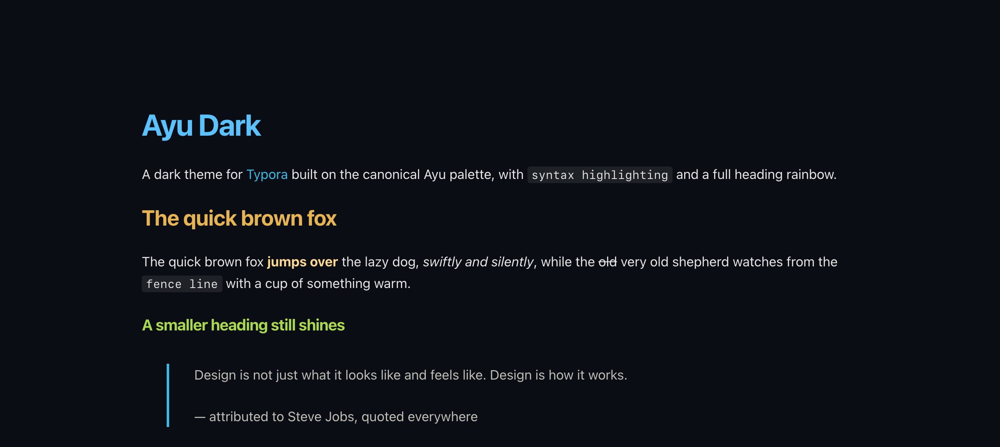
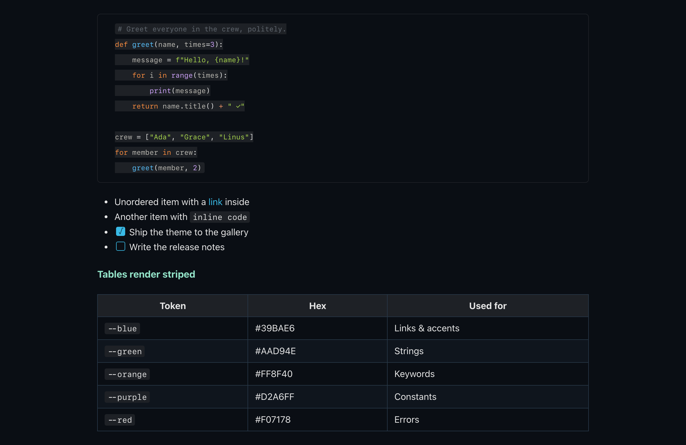

# Ayu Dark for Typora

A dark theme for [Typora](https://typora.io) built on the canonical [Ayu Dark](https://github.com/ayu-theme) palette.

## Features

- Complete Ayu Dark palette — heading rainbow (H1–H6), syntax highlighting for fenced code blocks and source mode, and fully styled macOS UI chrome (sidebar, quick open, megamenu, preferences, modals)
- Comfortable reading width (~780px), system font stack, JetBrains Mono / SF Mono for code (no bundled fonts)
- Styled tables with subtle borders and striped rows, blockquotes with accent border, task list checkboxes, image captions
- Print/PDF export rules with a light fallback so exported documents stay readable
- Self-contained single CSS file, MIT licensed

## Palette

| Role | Color |
|------|-------|
| Background | `#0A0E14` |
| Panel / surface | `#1E2126` |
| Selection | `#273747` |
| Foreground | `#E6E6E6` |
| Muted / comments | `#626A6E` / `#636A72` |
| Accent (blue) | `#39BAE6` |
| Signature yellow | `#E6B450` |
| Strings (green) | `#AAD94E` |
| Keywords (orange) | `#FF8F40` |
| Constants (purple) | `#D2A6FF` |
| Errors (red) | `#F07178` |

## Installation

1. Download `ayu-dark.css`
2. Copy it to Typora's theme folder:
   - **macOS:** `~/Library/Application Support/abnerworks.Typora/themes/`
   - **Windows:** `%APPDATA%\Typora\themes\`
   - **Linux:** `~/.config/Typora/themes/`
3. Restart Typora, then select **Ayu Dark** from the Themes menu

## Screenshots

### Typography

### Code & tables

## License

MIT © [Kyle Anderson](https://github.com/kylekanderson)

Based on [Ayu](https://github.com/ayu-theme) by Ike Ku, MIT licensed.
